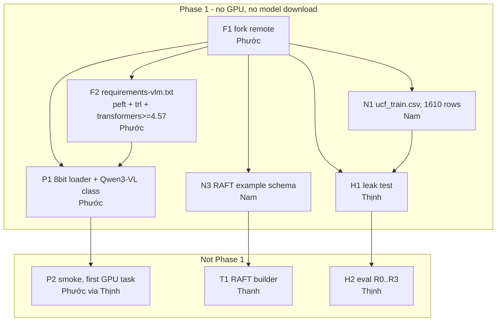

# Phase 1 tasks

Companion to `notes/2026-11-19-task-assignment-qwen3-vl-lora-raft.md`. That file is the whole project. This one is Phase 1 only, with the order and the bindings the assignment left implicit.

Phase 1 = everything that lands before the first GPU process. No model download, no GB10 compute, `pytest` stays green. The smoke run (P2) is the first task of Phase 2 and appears here only as the exit gate.

## 0. The six tasks

| Order | ID | Owner | Does | GPU |
|---|---|---|---|---|
| 1 | F1 | Phước | Fork remote. Source `main` not pushed to. README says trained, points back at the submitted AUC | no |
| 2 | F2 | Phước | Fork `requirements-vlm.txt`: add `peft`, `trl`, `transformers>=4.57`. `requirements-dev.txt` stays GPU-free | no |
| 3 | P1 | Phước | `vad/verify/vlm.py` accepts `quantization="8bit"`, adds the Qwen3-VL class. `"4bit"` and `"none"` unchanged, anything else raises | no |
| 4 | N1 | Nam | `scripts/build_train_manifest.py` + `manifests/ucf_train.csv`, 1610 rows, zero overlap with `ucf_test.csv` | no |
| 5 | N3 | Nam | RAFT example schema. One JSON under `tests/vad_suite/fixtures/`. Frozen after merge | no |
| 6 | H1 | Thịnh | Leak test. A test `video_id` in the train manifest or the index fails the run and names the id | no |

Not in Phase 1, so nobody starts them: F3, P0, P2, P3, N2, N4, T1, T2, T3, T4, H2, H3, H4.

## 1. Order

Serial where the arrow is. Parallel where the rows share a step.

| Step | Runs | Waits on |
|---|---|---|
| 1 | F1 | nothing |
| 2 | F2 and P1, same time | F1. Both touch the fork, different files |
| 3 | N1, N3, H1, all three at once | F1 only. None of them needs F2 or P1 |
| 4 | stop | N3 signed off by Thanh and Thịnh. H1 red for a planted test id, green for the real disjoint manifests |

F2 and P1 are both Phước, so "same time" means two branches, not two people. N1, N3, H1 are three people.

## 2. Bindings

A binding is a task that cannot start, or cannot be called done, until the other one is in a named state.

| Binding | From | To | State required | Why |
|---|---|---|---|---|
| B1 | F1 | F2, P1, N1, N3, H1 | fork URL posted, source `git log` unchanged | everything else is a commit on the fork. A branch on the submitted repo does not count |
| B2 | F2 | P1 | `transformers>=4.57` committed in the fork | the Qwen3-VL class is not in 4.49. P1's import has to resolve |
| B3 | N1 | H1 | `ucf_train.csv` rows exist, or H1 uses a fixture | the success half of H1 reads the real manifests. The failure half uses a planted fixture and can land first |
| B4 | N3 | T1 (Phase 2) | schema JSON merged, Thanh and Thịnh signed off | Thanh writes the RAFT builder against this schema. A silent field rename breaks his tests |
| B5 | P1 | P2 (Phase 2) | `"8bit"` unit test green, mocked, no download | the smoke run calls this branch. No loader, no smoke |
| B6 | H1 | H2 (Phase 3) | leak test merged | eval runs the leak check before it computes an AUC. A number produced first is discarded |

B4, B5, B6 cross the phase boundary. They are listed so Phase 1 does not merge something Phase 2 cannot consume.

## 3. Diagram

Read it as: F1 is the only root. F2 blocks P1 and nothing else. N1 blocks the green half of H1. The three arrows leaving the Phase 1 box are the only ways out, and each lands on a named later task.

## 4. Acceptance, one line each

| ID | Done when |
|---|---|
| F1 | Fork URL in the PR. `git log` of the source repo unchanged. `results/run_A4c/` hashes the same |
| F2 | `pip install -r requirements-dev.txt && python -m pytest -q` green, no model download |
| P1 | Test accepts `"8bit"`, keeps `"4bit"`, rejects `"2bit"`. Model mocked |
| N1 | Script exits non-zero on a planted test id. 1610 rows, 0 overlap with `manifests/ucf_test.csv` |
| N3 | Fixture JSON merged. Thanh and Thịnh both signed off. Schema frozen |
| H1 | Planted `Abuse028_x264` fails and the message names it. Real manifests pass |

Phase 1 is done when all six are merged to the fork and `python -m pytest -q` is green. That is the entry condition for P0, the gate check, which is Phase 2.
