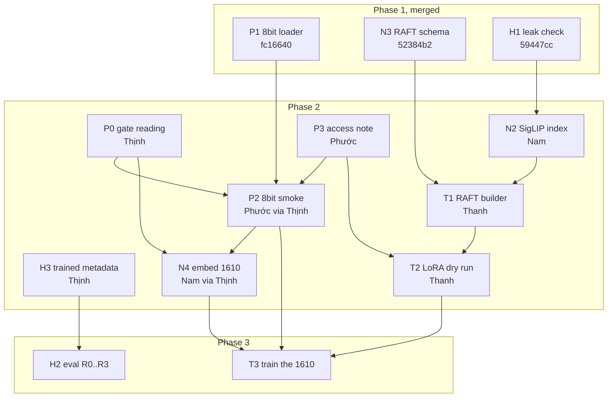

# Phase 2 tasks

Companion to `notes/2026-11-19-phase1-tasks.md` and `notes/2026-11-19-task-assignment-qwen3-vl-lora-raft.md`.

Phase 1 landed on `origin/main` at `8c004c3`. Phase 2 builds everything the training run needs and proves the 8-bit model loads once. It stops before training on the 1610. That run is T3, Phase 3.

Entry condition: Phase 1 merged, `python -m pytest -q` green. True as of `8c004c3` (749 passed).

GPU rule, unchanged: one GB10 process at a time, and only while `nvidia-smi` shows GPU-util under 10% for 10 continuous minutes. Never kill a resident job. Thịnh holds the box, so every GPU launch goes through him.

## 0. The eight tasks

| Order | ID | Owner | Does | GPU | Status |
|---|---|---|---|---|---|
| 1 | P0 | Thịnh | Gate reading. `notes/gb10-gate.md`: timestamp, util, temperature, resident PIDs, go or no-go | read-only | done, no-go (2026-11-19, util 95%, PIDs 548193 / 572109 / 572949) |
| 2 | N2 | Nam | `vad/index/siglip.py` + `scripts/build_raft_index.py`. Search drops the query `video_id`. A test id in the index raises | no | done |
| 3 | T1 | Thanh | `vad/train/raft.py`. P=0.6 golden, else distractors and `abstain=true`. Fixed seed | no | done |
| 4 | H3 | Thịnh | Dashboard metadata. `trained`, `adapter_id`, `base_model`, `quantization`, `raft_hits`. `schema_version` stays 1. UI shows `TRAINED` | no | done |
| 5 | P3 | Phước | `notes/gb10-access.md`. Host, port, who has a key, how a job dies with the ssh session | no | done |
| 6 | T2 | Thanh | `vad/train/lora.py` + `scripts/train_lora.py`. Frozen 8-bit base, LoRA r=16, alpha=32, dropout 0.05. Dry run on 2 examples | no | done (dry run only; `--run` still refuses without the smoke note) |
| 7 | P2 | Phước, launched by Thịnh | Smoke. Load `Qwen/Qwen3-VL-8B-Instruct` 8-bit, one window. `notes/qwen3-smoke.md` | yes, minutes | blocked, gate is no-go |
| 8 | N4 | Nam, launched by Thịnh | Embed the 1610 with the existing SigLIP 2 cache. Same model id, fps, dtype as the test cache | yes, hours | blocked, waits on P0 go and P2 exit 0 |

Not in Phase 2, so nobody starts them: T3, T4, H2, H4, F3. F3 is a README paragraph and rides along with H4 in Phase 4.

## 1. Order

| Step | Runs | Waits on |
|---|---|---|
| 1 | P0, N2, H3, P3 | Phase 1 only. Four independent tasks |
| 2 | T1 | N2. The builder calls `index.search` |
| 3 | T2 | T1 and P3. The dry run imports the builder and the launch note |
| 4 | P2 | P0 says go, P3 merged, and the loader from Phase 1 (`fc16640`) |
| 5 | N4 | P0 says go, and P2 has exited 0. Never beside the smoke run |
| 6 | stop | T2 dry run printed a trainable-parameter count. N4 cache readable by the test-split loader |

P0 and P2 and N4 all touch the GB10, so they are serial even though the table shows them in different steps. CPU work in steps 1-3 does not wait on the gate.

If P0 comes back no-go, steps 1-3 still finish. Steps 4 and 5 wait. Nobody queues, nobody polls the GPU in a loop.

## 2. Bindings

| Binding | From | To | State required | Why |
|---|---|---|---|---|
| B7 | P0 | P2, N4 | `notes/gb10-gate.md` says go, dated the same day as the run | a stale go from last week is not a go |
| B8 | N2 | T1 | `search(emb, k, exclude_video_id)` merged, with the test that the query id is absent from its own hits | T1 calls it. A different signature means T1's tests target a function that does not exist |
| B9 | N3 (Phase 1) | T1 | `tests/vad_suite/fixtures/raft_example.json` unchanged | the builder's output has to validate against that fixture. Editing the fixture to fit the builder is backwards |
| B10 | T1 | T2 | `vad/train/raft.py` importable, seed test green | the dry run builds two examples through it |
| B11 | P3 | P2, N4 | the launch command in the note reproduces | the smoke log is evidence only if someone else can rerun it |
| B12 | P1 (Phase 1) | P2 | `"8bit"` unit test green | the smoke calls that branch |
| B13 | P2 | T2's real run, and T3 (Phase 3) | `notes/qwen3-smoke.md` has peak memory and exit 0 | T2's script refuses to start without it. The dry run does not need it; the real run does |
| B14 | N4 | T3 (Phase 3) | train cache loads with the same loader as the test cache | RAFT retrieval is cosine over those vectors. A second fps or dtype splits the space |
| B15 | H3 | H2 (Phase 3) | a trained sample JSON round-trips and renders the `TRAINED` tag | eval output has to have somewhere to land |

B13, B14, B15 leave the phase. Listed here so Phase 2 does not merge a smoke log that Phase 3 cannot cite.

## 3. Diagram

Read it as: the top row is CPU and starts immediately. P2 is the first GPU process and the only one until it exits. N4 is the second and waits for P2. T3 is not in this phase.

## 4. Acceptance, one line each

| ID | Done when | Status |
|---|---|---|
| P0 | `notes/gb10-gate.md` has a timestamp, the util, the temperature, the resident PIDs, and a line that says go or no-go. A no-go is a finished task | done, no-go |
| N2 | A query video is absent from its own hits. Building the index with a planted test id raises and names it | done |
| T1 | P=0 gives all abstain, P=1 gives all golden, P=0.6 on a fixed seed matches a stored count. Output validates against `raft_example.json` | done |
| H3 | A sample JSON with `metadata.trained=true` round-trips through `RunResult`. `schema_version` 2 is still rejected. The Replay tab shows `TRAINED` | done |
| P3 | A second person runs the smoke command from `notes/gb10-access.md` without asking anything | done |
| T2 | Dry run on 2 examples prints the trainable-parameter count and writes `adapter_config.json`. It refuses to start a real run when `notes/qwen3-smoke.md` is missing | done |
| P2 | `notes/qwen3-smoke.md`: peak memory, seconds, bitsandbytes version, transformers version, driver, commit, exit 0. An OOM is recorded and stops the phase. No switch to 4-bit | not started |
| N4 | Train `.npy` files load with the same loader and the same model id, fps, dtype as the test cache. Count matches the shard that finished | not started |

As of 2026-11-19: P0, N2, T1, H3, P3, T2 are done. `python -m pytest -q` is 772 passed. P2 and N4 are not done. The gate says no-go, so neither has run, and `scripts/qwen3_smoke.py` does not exist yet.

Phase 2 is done when all eight are merged to the fork and `python -m pytest -q` is green. P2 and N4 are done when their notes name the commit, not when the tests pass.

If P2 OOMs, Phase 2 ends there. N4 does not start, T3 does not start, and the plan does not drop to 4-bit without a separate yes.
